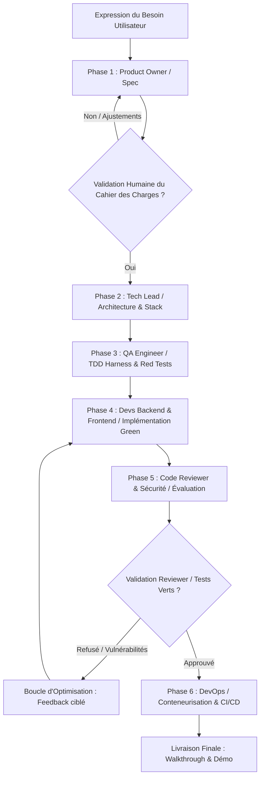

# WORKFLOW : CRÉATION D'UN NOUVEAU PROJET (*NEW-PROJECT*)

Ce workflow standardise la création intégrale d'un projet applicatif par l'équipe d'agents virtuels, depuis l'expression du besoin jusqu'à la première version opérationnelle et testée.

---

## Vue d'Ensemble du Pipeline

---

## Déroulement Étape par Étape

### Étape 1 : Cadrage & Spécification (*Product Owner*)
- **Agent responsable** : `product-owner` / `spec-architect`.
- **Entrées** : Description textuelle ou brief du projet par l'utilisateur.
- **Actions** :
  1. Analyser le périmètre fonctionnel et les personas cibles.
  2. Rédiger `projects/<nom_projet>/specs/SPEC.md` (objectifs, contraintes, hors-périmètre).
  3. Formaliser les User Stories dans `projects/<nom_projet>/specs/USER_STORIES.md` avec critères d'acceptation Gherkin (*Given / When / Then*).
  4. Créer la feuille de route initiale `projects/<nom_projet>/specs/ROADMAP.md`.
- **Sortie / Validation** : Présentation du cahier des charges à l'utilisateur pour validation.

### Étape 2 : Architecture & Conception Technique (*Tech Lead*)
- **Agent responsable** : `system-architect` / `tech-lead`.
- **Actions** :
  1. Choisir la stack technique la plus adaptée aux contraintes de performance, maintenabilité et vélocité.
  2. Rédiger les ADRs dans `projects/<nom_projet>/docs/adr/`.
  3. Spécifier les contrats d'API (`contracts/openapi.yaml` ou schémas TypeScript partagés).
  4. Modéliser la base de données (schéma relationnel ou document).
  5. Initialiser la structure de répertoires du projet.

### Étape 3 : Création du Harnais de Tests (*TDD Lead*)
- **Agent responsable** : `qa-engineer` / `tdd-lead`.
- **Actions** :
  1. Mettre en place le framework de test (Vitest/Jest, Pytest, etc.).
  2. Écrire les tests unitaires et d'intégration basés directement sur les critères Gherkin rédigés à l'étape 1.
  3. Exécuter la suite de tests pour vérifier qu'elle échoue fidèlement (**Phase RED**).

### Étape 4 : Implémentation du Code Métier (*Developers*)
- **Agents responsables** : `backend-dev` et `frontend-dev`.
- **Actions** :
  1. Développer les services, modèles, routes API et composants d'interface.
  2. Exécuter les tests en continu jusqu'à obtenir le passage de l'intégralité de la suite au vert (**Phase GREEN**).
  3. Refactoriser le code pour éliminer les duplications et clarifier la structure (**Phase REFACTOR**).

### Étape 5 : Revue de Code & Audit Sécurité (*Evaluator-Optimizer*)
- **Agent responsable** : `code-reviewer` / `security-auditor`.
- **Actions** :
  1. Exécuter l'analyse statique et le linter.
  2. Vérifier l'absence de vulnérabilités OWASP Top 10 (injections, failles d'auth, fuites de données).
  3. Contrôler le respect des seuils de couverture de code (>= 80%).
  4. Si des défauts sont relevés : émettre un rapport structuré `AUDIT_REPORT.md` avec remédiations précises et renvoyer à l'étape 4 (jusqu'à 3 itérations automatiques).
  5. Dès conformité atteinte : délivrer le tampon `STATUS: APPROVED`.

### Étape 6 : DevOps, Packaging & Livraison (*DevOps Engineer*)
- **Agent responsable** : `devops-engineer`.
- **Actions** :
  1. Créer le `Dockerfile` multi-stage optimisé (taille minimale, utilisateur non-root).
  2. Créer le `docker-compose.yml` pour le lancement local en un seul clic (`docker compose up --build`).
  3. Configurer la CI/CD (`.github/workflows/ci.yml` : lint, test, build, security scan).
  4. Rédiger le `README.md` complet du projet généré avec les instructions de démarrage.
  5. Produire l'artefact de clôture `walkthrough.md` résumant l'ensemble de la réalisation.
