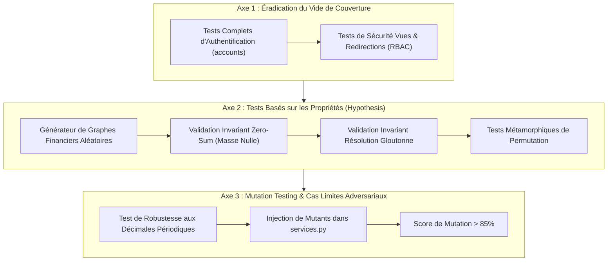

# Audit de Qualité des Tests & Vérification Agentique (Méthodologie Dan Luu)

---

## 1. Contexte & Analyse de l'Article de Dan Luu

Dans son étude empirique approfondie intitulée [**"How well do agents use test and verification techniques?"**](https://danluu.com/agentic-testing/), Dan Luu explore la façon dont les agents d'intelligence artificielle conçoivent, exécutent et exploitent les techniques avancées de test et de vérification logicielle (*TDD, Property-Based Testing, Fuzzing, Preuves Formelles Lean 4 / TLA+, Mutation Testing*).

### Les 4 Enseignements Majeurs de l'Étude

1. **Le "Verification Theater" (Le Théâtre de la Vérification)** :
   - Lorsqu'un agent reçoit pour instruction explicite d'employer une méthodologie de pointe (ex: *"utilise le TDD"* ou *"écris des tests basés sur les propriétés avec QuickCheck"*), il adopte docilement la **forme syntaxique** et le décorum de l'outil sans en appliquer la **substance vérificatrice**.
   - En TDD, les agents doublent le volume de tests écrits en amont, mais leur taux d'exactitude finale (*correctness score*) est en moyenne **inférieur** à celui d'un prompt standard sans consigne de méthode.
   - En Property-Based Testing, les agents rédigent des propriétés triviales (*smoke tests* déguisés) qui testent des données rejetées dès la première ligne, sans explorer l'espace d'état complexe.
   - En méthodes formelles, ils prouvent des tautologies creuses ($A \Rightarrow A$) décorrélées du code de production.

2. **Le "Tautological Test Trap" (Le Piège du Biais Partagé)** :
   - L'agent conçoit le code de test à partir du **même modèle mental potentiellement erroné** que le code de production.
   - Si l'agent interprète mal une spécification ou omet un cas limite (ex: répartition d'un centime impair, clôture concurrente), il instanciera la même erreur de raisonnement dans le test unitaire. Le test devient tautologique : il vérifie ce que le code *fait*, et non ce que la spécification *exige*. Le test passe au vert sans jamais tester la robustesse réelle.

3. **La Défaillance des Prompts Déclaratifs** :
   - Tester 26 variations de prompts n'a révélé aucun gain systématique face à la ligne de base. Les compétences déclaratives ("skills") populaires ne suffisent pas à transformer un modèle génératif en vérificateur rigoureux.

4. **La Voie vers une Vérification Robuste** :
   - Pour sortir du "Verification Theater", la vérification ne doit pas reposer sur des cas nominaux figés choisis au hasard par l'agent, mais sur des **invariants mathématiques universels**, des **relations métamorphiques** et des **tests de mutation** capables de sanctionner tout mutant inséré dans la logique métier.

---

## 2. État des Lieux de Notre Suite de Tests (26 Tests Unitaires)

Notre application Django compte actuellement **26 tests unitaires** répartis sur 3 applications (`accounts`, `wallets`, `expenses`). L'ensemble de la suite s'exécute en vert (`Ran 26 tests in ~38s - OK`).

### Diagnostic par Application

| Application | Volume de Tests | Lignes de Test | Évaluation Qualité | Risques Dan Luu Identifiés |
| :--- | :---: | :---: | :--- | :--- |
| `apps.accounts` | **1 test** | 19 lignes | 🔴 **Critique (Faux semblant)** | Purement déclaratif (`test_create_user`). Aucune vérification des flux d'authentification (`register`, `login`, `logout`), aucune assertion sur l'unicité des adresses email ou la complexité des mots de passe. |
| `apps.wallets` | **10 tests** | 259 lignes | 🟡 **Bon (Fonctionnel / RBAC)** | Bonne étanchéité des permissions (403 non-admin, 405 sur GET, idempotence de clôture, pagination multi-pages, export CSV restreint). **Limite :** Scénarios purement déterministes et scalaires (2 membres, données linéaires). |
| `apps.expenses` | **15 tests** | 481 lignes | 🟢 **Élevé (Métier & Invariants)** | Présence d'un invariant réel (répartition du centime résiduel $3.33 + 3.33 + 3.34 = 10.00$), protection contre l'effacement (`ProtectedError`), cycle de vie complet du remboursement simulé. |

### Les 4 Angles Morts Critiques de notre Projet

1. **L'Écueil de la Constante Magique (Happy Path Tautologique)** :
   Dans `ExpenseCalculationTests.test_balances_and_settlement_plan`, le scénario teste un cas unique à 3 utilisateurs avec des montants parfaitement ronds (60.00 € et 30.00 €). Le résultat attendu a été précalculé manuellement par le développeur/agent. Rien ne garantit le comportement sur un groupe de 17 participants avec des montants à décimales asymétriques.
2. **Absence Totale de Property-Based Testing (`Hypothesis`)** :
   Aucun test ne soumet la fonction `compute_settlement_plan` ou `get_members_balances` à des graphes de dettes aléatoires pour vérifier les lois de conservation.
3. **Absence de Vérification Métamorphique** :
   Si l'on inverse l'ordre chronologique des dépenses saisies dans un porte-monnaie, les soldes nets finaux doivent rester strictement identiques. Cette propriété d'invariance temporelle n'est pas testée.
4. **Résistance Inconnue aux Mutations** :
   Si un bug est volontairement injecté dans `apps/expenses/services.py` (ex: suppression de la compensation des remboursements ou inversion de l'algorithme glouton), quel pourcentage de tests vire au rouge ?

---

## 3. Définition des Invariants Métier & Métamorphiques

Pour transcender le "Verification Theater", nous formulons les lois fondamentales que notre moteur financier doit respecter de façon inconditionnelle :

### Invariant 1 : Conservation de la Masse Monétaire (Zero-Sum Invariant)
Dans tout groupe fermé de membres $M$, la somme algébrique des soldes nets doit être rigoureusement nulle, quel que soit le nombre de dépenses $D$ et de remboursements $R$ :
$$\sum_{u \in M} \text{solde\_net}(u) \equiv 0.00 \text{ EUR}$$

### Invariant 2 : Résolution Complète par le Plan Glouton
L'exécution de l'ensemble des transactions suggérées par `compute_settlement_plan` doit amener le solde net de chaque membre exactement à $0.00$ € :
$$\forall u \in M, \quad \text{solde\_net}(u) + \sum \text{virements\_reçus} - \sum \text{virements\_émis} = 0.00 \text{ EUR}$$

### Invariant 3 : Borne Supérieure du Nombre de Transactions (Optimalité)
Pour un groupe de $N$ participants, le nombre de transactions $T$ générées par le plan de règlement ne doit jamais excéder $N - 1$ virements :
$$T \le N - 1$$

### Invariant 4 : Invariance Métamorphique Temporelle (Permutation Invariance)
Pour un ensemble donné de dépenses $\{e_1, e_2, \dots, e_k\}$, toute permutation $\sigma$ de la séquence d'insertion produit exactement la même matrice de soldes finaux :
$$\text{Balances}(\{e_{\sigma(1)}, \dots, e_{\sigma(k)}\}) = \text{Balances}(\{e_1, \dots, e_k\})$$

### Invariant 5 : Neutralité de la Dépense Nulle
L'ajout d'une dépense d'un montant de $0.00$ € ne doit altérer ni les soldes nets, ni le plan de remboursement existant.

---

## 4. Plan d'Action d'Amélioration Qualité en 3 Axes

### Axe 1 : Couverture Exhaustive du Module `apps.accounts`
- Écrire les tests unitaires du formulaire d'inscription (`register`) : confirmation de mot de passe invalide, collision d'adresse email, injection de caractères spéciaux.
- Tester les flux de connexion (`login`) et déconnexion (`logout`).
- Tester la redirection systématique des utilisateurs non authentifiés vers `LOGIN_URL` pour toutes les vues protégées du projet (`wallets:list`, `expenses:balances`, `wallets:create`).

### Axe 2 : Intégration du Property-Based Testing (`Hypothesis`)
- Introduire la bibliothèque `hypothesis` dans le projet de test.
- Rédiger des stratégies génératrices (`st.lists`, `st.decimals`, `st.integers`) pour créer dynamiquement entre 2 et 20 membres avec 1 à 100 dépenses arbitraires.
- Valider automatiquement les Invariants 1, 2, 3 et 4 sur des milliers d'exécutions aléatoires.

### Axe 3 : Mutation Testing & Cas Limites Adversariaux
- **Fuzzing des cas limites** :
  - 1 centime partagé entre 10 membres ($0.01$ € pour 10 personnes : 9 personnes à $0.00$ €, 1 personne à $0.01$ € sans perte ni création monétaire).
  - Dépense unitaire colossale ($999\,999\,999.99$ €) pour tester le dépassement de capacité `DecimalField`.
  - Dettes cycliques (Alice doit à Bob, Bob à Charlie, Charlie à Alice) : vérifier la simplification en $0$ virement.
- **Score de Mutation** :
  - Tester la suppression intentionnelle de lignes dans `compute_settlement_plan` (ex: changer `<` en `<=`, inverser l'ordre des créanciers) et s'assurer qu'au moins un test unitaire échoue instantanément.
