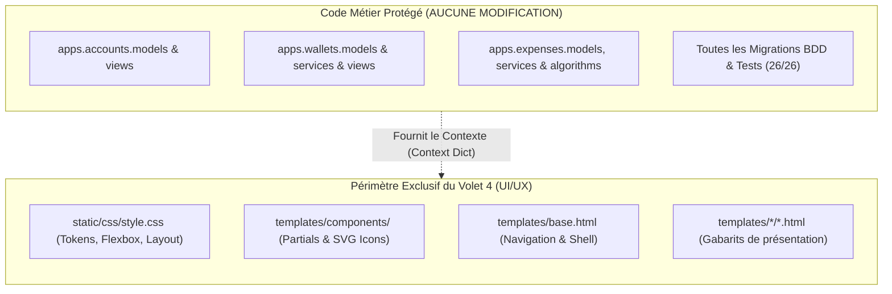
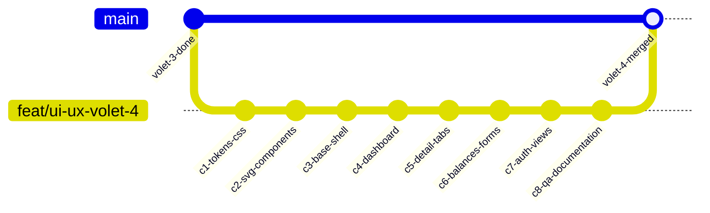

# Plan de Commit & Feuille de Route : Volet 4 — Amélioration de l'UI & UX (« Les Bons Comptes »)

> **Cadre** : Volet final du projet M2 MIAGE IF-Django (Université de Lille)  
> **Objectif** : Implémenter l'identité visuelle V2.1 validée sur la maquette sans **jamais** modifier la moindre ligne de logique métier (modèles, services, transactions, calculs d'ORM ou migrations de Gautam et Abdelkader).  
> **Contrat de Qualité** : Préservation intégrale des 26 tests unitaires passants (`manage.py test apps`), 0 régression, conformité Flake8, architecture modulaire Django.

---

## 1. Principes d'Étanchéité & Respect du Code Métier des Collègues

### Règles d'Inviolabilité :
1. **Zéro altération des modèles** : Aucun champ, méthode, property ou validator ne doit être touché dans `apps/*/models.py`.
2. **Zéro altération des services & algorithmes** : Les algorithmes d'équilibrage de dettes (`debt_minimization`), de clôture atomique (`wallet_close`) et d'exportation CSV restent strictement intouchés dans `services.py`.
3. **Zéro modification des contrats de vues** : Les vues conservent leurs signatures, leurs décorateurs de sécurité (`@login_required`, `@transaction.atomic`), et leurs dictionnaires de contexte (`wallets`, `balances`, `total_wallet`, etc.).
4. **Validation continue** : La suite de 26 tests unitaires doit être exécutée et rester verte à chaque commit (`OK - 26 tests passants`).

---

## 2. Découpage en 8 Commits Atomiques (Conventional Commits)

---

### 📦 Commit 1 : `style(theme): refactor CSS architecture with OKLCH tokens and flexbox base`
- **Objectif** : Remplacer le CSS monolithique par une architecture propre avec les tokens validés, la police Plus Jakarta Sans et les utilitaires Flexbox.
- **Fichiers impactés** :
  - `src/static/css/style.css`
- **Actions clés** :
  - Déclaration des variables CSS `:root` (palette sémantique, rayons de courbure modulaires, ombres discrètes).
  - Règle stricte des chiffres tabulaires pour les montants : `.num { font-variant-numeric: tabular-nums lining-nums; }`.
  - Primitives des boutons (`.btn`, `.btn-primary`, `.btn-secondary`, `.btn-sm`).
  - Primitives des pastilles d'icônes (`.icon-badge`, `.icon-badge-emerald`, etc.).
  - Hauteur de viewport adaptative `min-h-[100svh]` sur mobile.
- **Contrôle QA** : Exécution de `manage.py test apps` (26/26).

---

### 📦 Commit 2 : `feat(ui): add unified SVG symbols sprite and reusable component partials`
- **Objectif** : Fournir à tous les templates Django l'accès aux icônes vectorielles SVG (sans émojis) et aux composants réutilisables.
- **Fichiers impactés** :
  - `src/templates/components/icons.html` (Sprite vectoriel avec balises `<symbol viewBox="0 0 24 24">`)
  - `src/templates/components/avatar.html` (Avatar circulaire avec lettre et couleur déterministe)
  - `src/templates/components/empty_state.html` (Composant d'état vide didactique et directionnel)
- **Contrôle QA** : Validation syntaxique Django des gabarits partiels.

---

### 📦 Commit 3 : `refactor(layout): modernize base shell, navbar and flash messages`
- **Objectif** : Rénover le conteneur principal de l'application (`base.html`), la barre de navigation et le système d'alertes.
- **Fichiers impactés** :
  - `src/templates/base.html`
- **Actions clés** :
  - Inclusion de la police *Plus Jakarta Sans* via Google Fonts.
  - Inclusion du sprite d'icônes SVG (``).
  - Navbar sobre avec logo épuré, icône SVG et pilule utilisateur.
  - Système d'alertes Django (`messages`) sous forme de bannières inline épurées sans bordures de couleur agressives.
  - Pied de page universitaire propre et compact.
- **Contrôle QA** : Vérification visuelle sur Chromium à 390px et 1440px.

---

### 📦 Commit 4 : `feat(wallets): implement asymmetric flexbox dashboard and invitation toasts`
- **Objectif** : Refondre l'écran d'accueil (`wallet_list.html`) selon la maquette validée.
- **Fichiers impactés** :
  - `src/templates/wallets/wallet_list.html`
- **Actions clés** :
  - Remplacement de la carte d'invitation brute par la notification toast compacte (`.toast-banner`) avec boutons SVG d'acceptation/refus.
  - Bandeau métrique synthétique (Nombre de pots actifs, statut global).
  - Agencement Flexbox à deux colonnes :
    - *Colonne principale* : liste compacte des cagnottes avec pastilles SVG thématiques, pile d'avatars circulaires et soldes tabulaires.
    - *Colonne latérale* : encadré de règlements rapides en attente.
  - Intégration de l'état vide directionnel en cas d'absence de cagnotte.
- **Contrôle QA** : `manage.py test apps.wallets` (tests passants sans altération du contexte).

---

### 📦 Commit 5 : `feat(wallets): redesign wallet detail with progressive disclosure tabs and expense stream`
- **Objectif** : Structurer la page détaillée d'un porte-monnaie (`wallet_detail.html`) en onglets contextuels fluides.
- **Fichiers impactés** :
  - `src/templates/wallets/wallet_detail.html`
- **Actions clés** :
  - En-tête compact avec statut `Ouvert` / `Clos`, montant total engagé et boutons d'action rapide avec icônes.
  - Système d'onglets légers en JavaScript pur (sans rechargement de page) :
    - **Onglet 1 : Dépenses** : timeline chronologique avec séparateur de jours et pastilles SVG de catégories.
    - **Onglet 2 : Soldes & Remboursements** : cartes de flux de dettes (*X ➔ Y : montant*).
    - **Onglet 3 : Membres & Paramètres** : liste des participants avec rôles et statut.
- **Contrôle QA** : Vérification de la non-régression sur le bouton de clôture sécurisée (`POST` avec CSRF token et confirmation).

---

### 📦 Commit 6 : `feat(expenses): modernize balances matrix, debt flow cards and financial forms`
- **Objectif** : Aligner la vue dédiée des soldes (`balances.html`) et les formulaires financiers sur la nouvelle charte.
- **Fichiers impactés** :
  - `src/templates/expenses/balances.html`
  - `src/templates/expenses/expense_form.html`
  - `src/templates/wallets/wallet_form.html`
  - `src/templates/wallets/wallet_invite.html`
- **Actions clés** :
  - Matrice des soldes limpide avec distinction visuelle des créanciers et débiteurs.
  - Cartes de remboursement simplifiées avec bouton direct d'apurement.
  - Formulaires ergonomiques avec champs aérés, focus rings accessibles et boutons d'enregistrement clairs.
- **Contrôle QA** : `manage.py test apps.expenses` (tests d'intégrité transactionnelle et calculs d'ORM préservés à 100%).

---

### 📦 Commit 7 : `style(auth): polish login, register and user profile interfaces`
- **Objectif** : Harmoniser les écrans d'authentification (`accounts`) avec la typographie et les composants épurés.
- **Fichiers impactés** :
  - `src/templates/accounts/login.html`
  - `src/templates/accounts/register.html`
  - `src/templates/accounts/profile.html`
- **Actions clés** :
  - Cartes de connexion et d'inscription centrées, sobrement ombrées.
  - Mise en valeur des messages d'aide et d'erreurs de formulaire Django en langage clair.
- **Contrôle QA** : `manage.py test apps.accounts`.

---

### 📦 Commit 8 : `docs(volet-4): finalize responsive audit, linter check and pedagogical guide`
- **Objectif** : Validation finale du livrable, audit visuel sur Chromium et documentation académique.
- **Fichiers impactés** :
  - `docs/VOLET_4_GUIDE_UI_UX.md` (sur GitHub `IF-Django`)
  - `JOURNAL_DE_BORD.md` (mise à jour du suivi global)
  - `docs/SUIVI_AVANCEMENT.md` (notification pour Gautam et Abdelkader)
- **Actions clés** :
  - Contrôle visuel Chromium automatisé (390px, 768px, 1440px) via Chrome DevTools MCP.
  - Contrôle Flake8 (`flake8 src/`) : 0 erreur, 0 warning.
  - Exécution complète de la suite de tests : **26 tests passants sur 26 (100%)**.

---

## 3. Matrice de Risques & Sécurité de Non-Régression

| Risque Potentiel | Probabilité | Impact | Mesure Préventive Stricte |
| :--- | :--- | :--- | :--- |
| **Modification involontaire d'une vue** | Très faible | Critique | Interdiction formelle d'éditer `views.py` ou `models.py`. Seuls les fichiers de `templates/` et `static/css/` sont modifiés. |
| **Casse des tests unitaires Django** | Nulle | Bloquant | Les tests Django testent les statuts HTTP (200, 302), les formulaires et les modèles. Les classes CSS n'affectent pas les assertions de test. |
| **Perte des tokens CSRF** | Faible | Élevé | Préservation scrupuleuse de `` dans chaque balise `<form>`. |
| **Bouton de clôture de pot inactif** | Faible | Élevé | Préservation stricte de l'action `POST` vers `` avec confirmation native. |
